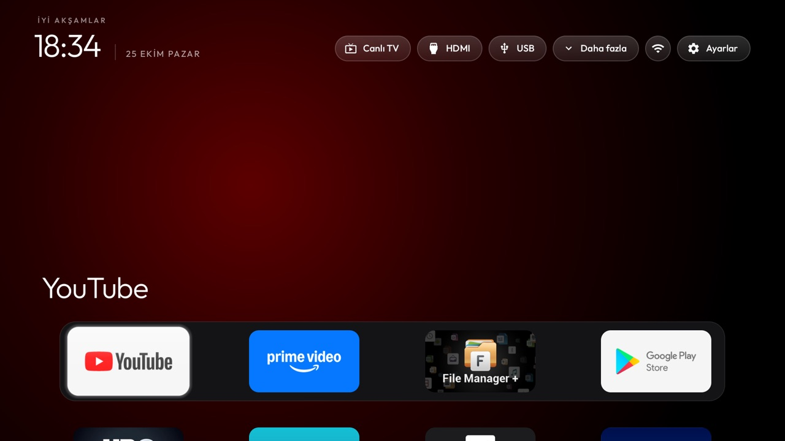
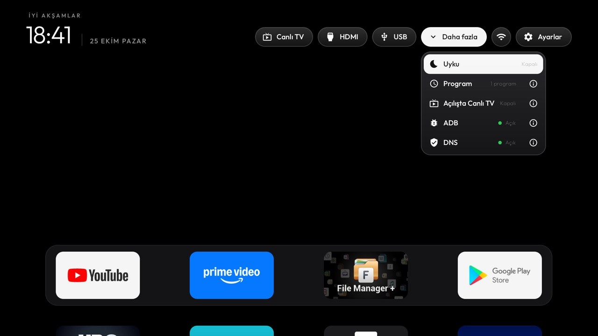
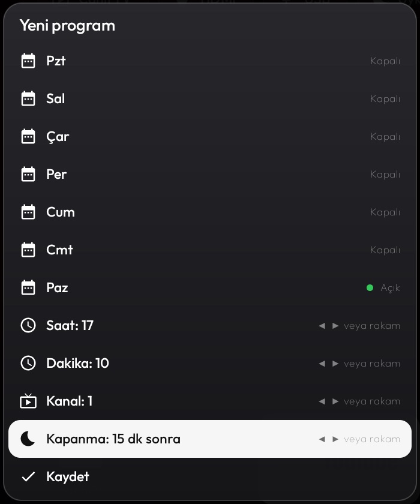
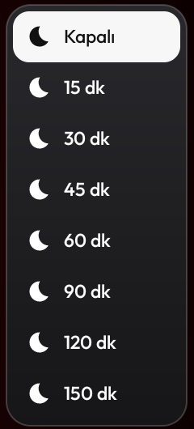
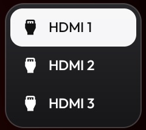

# Dijitsu 43DS9800 – CleanYourTV

[Türkçe](#türkçe) · [English](#english)





| Program | Uyku / Sleep | HDMI |
|---|---|---|
|  |  |  |

---

## Türkçe

Bu klasör, **Dijitsu 43DS9800** televizyonunun reklam, öneri ve gereksiz yazılımlardan nasıl temizlendiğini ve
yerine sade, hızlı bir ana ekranın nasıl kurulduğunu anlatır. [CleanYourTV](https://github.com/Gathin23/cleanyourtv)
projesinin bir fork'udur. Aynı CVTE / MediaTek MT9216 kartını kullanan diğer Dijitsu modellerine de büyük
ölçüde uymalıdır, ancak yalnızca 43DS9800 üzerinde test edildi.

> **Uyarı:** Resmî değildir; Dijitsu veya CVTE ile ilgisi yoktur. Her şey kendi sorumluluğunuzdadır. Hiçbir şey
> silinmez, paketler yalnızca devre dışı bırakılır ve geri alınabilir. Yine de garanti ve servis konusunda kendi
> kararınızı verin.

### TV hakkında

| | |
|---|---|
| Kart | CVTE `TPD.MT9216.PB767`, ürün `mt5867_eu`, model `SMART_TV` |
| Sistem | Android 11 (API 30), `userdebug/dev-keys`, firmware `20221017_175037` |
| RAM | ~1 GB |
| Not | Sertifikalı Android TV değil. **Geliştirici seçenekleri** ve standart Android Ayarları yok. |

### Önemli bulgu: gizli sistem uygulaması

Firmware içinde `/system/app/clean/clean.apk` olarak gelen, kendini `com.android.media.tools` diye tanıtan bir
uygulama var:

- Kod isimleri bilerek okunmaz yapılmış (`org.oo.o0o.o00o…`), içinde `hades.apk` / `hadesdex` ve
  `DexClassLoader` geçiyor; yani internetten kod indirip çalıştırabiliyor.
- Açılışta kendiliğinden başlıyor, ~19 işlemle çalışıyor; incelendiğinde 30'dan fazla sunucuya açık bağlantısı
  vardı (12341, 12342, 9443, 8001 gibi portlar).
- Üreticinin `/vendor/tvconfig/menu_config_xml/cvte_white_black_list.ini` dosyasında `[startup]` ve `[keeplive]`
  listelerinde geçiyor.
- SHA-256: `fb0ce660c8534a31eed39ddabc50fc00b5ab11763e56ee70bb98795148a899c6`

Hangi kötü amaçlı yazılım ailesine ait olduğu bilinmiyor; davranışı ucuz Android TV cihazlarında görülen
reklam/proxy yazılımlarına benziyor. Devre dışı bırakılınca bütün bağlantıları kesildi ve yeniden başlatmadan sonra
da kapalı kaldı. Kendi TV'nizde kontrol etmek için:

```bash
tools/venv/bin/python -I tools/tv.py 'pm list packages -f | grep media.tools'
```

### Neler yapıldı

**Devre dışı bırakılanlar** ([debloat.txt](debloat.txt)): gizli uygulama, ekran koruyucu/duvar kağıdı içerik
servisi, üretici mağazası, hava durumu, "TV asistanı" temizleyici, partner satırları, demo modu, Google geri
bildirim ve üreticinin uzaktan destek/ekran kaydı servisi.

**Yeni ana ekran** (bu fork'taki launcher), üst çubukta:

| Düğme | Ne yapar |
|---|---|
| **Canlı TV** | HDMI'dayken bile doğrudan DTV'ye geçer (TV'nin TIF oynatıcısı, `sourceId=0`). |
| **HDMI** | HDMI 1 / 2 / 3 menüsü; seçilen porta doğrudan geçer (`sourceid` 5/6/7). |
| **USB** | TV'nin kendi Medya Merkezi'ni açar (USB bellekteki video, müzik, fotoğraf). |
| **Daha fazla ⌄** | Açılan menüde **Uyku**, **Program**, **Açılışta Canlı TV**, **ADB** ve **DNS** (AdGuard reklam engelleyici DNS, açılıp kapatılabilir) bulunur. Son dördünün yanındaki **ⓘ** (sağ tuşla geçilir) ne işe yaradığını kısaca anlatır. Uyku açıkken kalan süre bu düğmede de yazar. |
| ↳ Uyku | TV'nin kendi uyku zamanlayıcısı: 15–150 dk. |
| ↳ Program | Seçilen günlerde ve saatte istenen kanalı açar; isteğe bağlı olarak süre sonunda TV'yi kapatır. **TV kapalıyken de çalışır.** |
| ↳ Açılışta Canlı TV | Açık (yeşil nokta): TV açılınca DTV gelir. Kapalı: ana ekran gelir ve odak **Canlı TV** düğmesinde olur; sonradan ana ekrana dönünce odak yine dock'tadır. Hem yeniden başlatmada hem bekleme modundan açılışta geçerlidir; o anda bir program varsa programın kanalı öncelikli. |
| Wi-Fi | Yalnızca simge; Wi-Fi, kablolu ve bağlantı yok durumları için farklı simge. |

**Program nasıl çalışır:** Program ekranında günler OK ile açılıp kapanır; saat, dakika, kanal ve kapanma süresi
◀ ▶ ile değişir ya da kumandanın rakam tuşlarıyla yazılır. Bir sonraki program TV'nin kendi **açılma
zamanlayıcısına** da yazılır; TV bekleme modundaysa donanım saatiyle uyanır, launcher kanalı açar ve kapanma
süresini TV'nin uyku zamanlayıcısına kurar. Test: TV bekleme modundaydı (ağdan tamamen düşmüştü), 17:10:00'da
kendisi açıldı ve 17:10:11'de 1 numaralı kanala geçti.

**Diğer düzeltmeler:**

- Ses ve Home tuşu: Launcher'ın yardımcısı tuş **filtrelemez** (bu klasördeki `config.json`: `"key_filter": false`). Bu TV'de filtre açıkken ses
  tuşunun basılı tutma tekrarı kayboluyor; CVTE'nin global tuş yöneticisi de ses tuşlarını erişilebilirlik
  servislerinden önce tükettiği için launcher tekrarı kendisi de yapamıyor. Filtre kapalıyken ses doğal hâliyle sürekli
  artar/azalır. Bedeli: Home'a basınca üreticinin eski ana ekranı kısa bir an görünür, yardımcı hemen yeni ana ekrana
  geçirir (`stock_home_redirect`). Eski ana ekran kapatılmıyor, çünkü CVTE kartlarda kapatmak açılışı kilitleyebilir.
- Bu TV'nin ayarlarında "Tüm dosyalara erişim" ve "Bilinmeyen uygulama yükleme" ekranları yok. Dosya yöneticisi
  gibi uygulamalar izin isteyince hiçbir şey açılmıyor; izin ADB ile verilir (aşağıda).

### Kurulum

**1. ADB'yi açın.** Geliştirici seçenekleri olmadığı için ADB yalnızca gizli fabrika menüsünden açılır: kumandada
**menü (üç çizgi) tuşu + 1147**, sonra **DEBUG → ADB**. Ana ekranda tepki vermezse Canlı TV'yi açıp orada deneyin.

> Fabrika menüsünde **yalnızca DEBUG**'a dokunun. FACTORY MODE, SHIPPING INIT, AGING MODE, SW UPGRADE ve BOARD
> INIT TV'yi sıfırlayabilir veya bozabilir. Çıkmak için Geri/Exit.

TV ile bilgisayar aynı ağda olmalı. TV'nin IP adresini fabrika menüsünün alt kısmında (IP satırı) görebilirsiniz.

**2. Araçları hazırlayın** (macOS / Linux):

```bash
git clone https://github.com/mehmetfurkaneroglu/cleanyourtv-dijitsu.git
cd cleanyourtv-dijitsu
python3 -m venv tools/venv && tools/venv/bin/pip install -r tools/requirements.txt
export TV_HOST=192.168.1.50   # kendi TV'nizin IP adresi
tools/venv/bin/python -I tools/tv.py --probe
```

**3. Gereksizleri kapatın:**

```bash
tools/disable.sh examples/dijitsu-43ds9800/debloat.txt
```

**4. Ana ekranı kurun** (JDK 17 ve Android SDK platform 34 gerekir):

```bash
HOME_KEY_SERVICE=1 STOCK_LAUNCHER=none launcher/build-and-install.sh
tools/theme.sh examples/dijitsu-43ds9800
```

Son satır bu klasördeki `config.json`'ı yükler: `"key_filter": false` ile ses tuşunun basılı tutma tekrarı korunur.

Dock'taki uygulamaları `launcher/app/src/main/res/values/config.xml` içindeki `dock_apps` listesinden ya da TV'de
**Ayarlar düğmesinde OK'a basılı tutup → "Dock'u düzenle"** ile değiştirebilirsiniz.

> **Türkçe macOS'ta derleme:** Türkçe sistem dilinde Gradle "İ" harfi yüzünden hata verir. Derlemeden önce:
> `export LC_ALL=en_US.UTF-8 JAVA_TOOL_OPTIONS="-Duser.language=en -Duser.country=US"`

USB bellek takılınca Medya Merkezi'nin çıkardığı "USB cihazı takılı" uyarısını kapatın (üst çubukta zaten USB düğmesi
var; Medya Merkezi o düğmeyle açılmaya devam eder):

```bash
tools/venv/bin/python -I tools/tv.py 'appops set com.cvte.tv.media SYSTEM_ALERT_WINDOW deny'
```

Geri almak için aynı komutta `deny` yerine `default` yazın.

Launcher'ın ayarlardan ADB'yi açıp kapatabilmesi için bir kez izin verin:

```bash
tools/venv/bin/python -I tools/tv.py 'pm grant com.gathin.tvhome android.permission.WRITE_SECURE_SETTINGS'
```

**5. TV'yi bir kez yeniden başlatın**, sonra Home, Canlı TV, HDMI ve ses tuşunu gerçek kumandayla deneyin.

**6. İzin gereken uygulamalar** (örnek: dosya yöneticisi, kendini güncelleyen uygulamalar). `PAKET` yerine
uygulamanın paket adını yazın:

```bash
tools/venv/bin/python -I tools/tv.py 'appops set PAKET MANAGE_EXTERNAL_STORAGE allow'
tools/venv/bin/python -I tools/tv.py 'appops set PAKET REQUEST_INSTALL_PACKAGES allow'
```

Yükleme izni verdiğiniz uygulama TV'ye istediği APK'yı kurabilir; yalnızca güvendiğiniz uygulamalara verin.

**7. ADB'yi kapatın.** Port 5555 şifresizdir; bu firmware'de ağdaki her cihaz onay istemeden bağlanabilir.
**Daha fazla** menüsündeki **ADB** satırına basın (ya da fabrika menüsünden DEBUG → ADB). Yanındaki **ⓘ** düğmesi
(sağ tuşla geçilir), TV'nin IP adresiyle nasıl bağlanılacağını gösterir. Sonra kontrol edin:

```bash
tools/adb-closed.py 192.168.1.50
```

### Bu TV'ye özgü notlar

- **Play Store Canlı TV'de kapanıyor:** Üretici, 1 GB RAM'den tasarruf için Canlı TV öndeyken Play Store ve Play
  Hizmetleri'ni kapatır, Canlı TV'den çıkınca geri açar (`cvte_white_black_list.ini`, `[disableinlivetv]`). Arıza
  değildir.
- **"YouTube" sahtesi:** Üretici mağazasından gelen, YouTube'un paket adını kullanan "WebTube" adlı bir uygulama
  vardı. Kaldırılıp Play Store'dan resmî "YouTube for Android TV" kuruldu.
- **Bluetooth yok:** Yazılım Bluetooth'u listeliyor ama adaptör açılmıyor ve adresi yok; bu modelde Bluetooth donanımı bulunmuyor.
- **Kanal numarası:** Program, kanalı numarasıyla açar (TV API `TuneChannelByLcn`). Bu TV'de DTV, uydu (DVB-S)
  yayınıdır.
- **Tek açılma zamanlayıcısı:** TV'nin bir tane açılma zamanlayıcısı var; her zaman sıradaki program yazılır.
  Program kalmayınca launcher, kendi kurduğu zamanlayıcıyı kapatır.
- Launcher'ın kullandığı TV API kodları (kanal, uyku, açılma zamanlayıcısı) `CvteTv.java` ve `SleepTimer.java`
  içinde, firmware'in `/system/framework/cn.cvte.tv.api.jar` dosyasından çıkarılan değerlerle belgelenmiştir.

### Geri almak

```bash
tools/restore.sh examples/dijitsu-43ds9800/debloat.txt
tools/venv/bin/python -I tools/tv.py 'settings put secure enabled_accessibility_services ""; cmd package set-home-activity --user 0 com.cvte.tv.launcher.fall/.MainActivity'
```

Tek bir uygulamayı geri açmak için: `tools/venv/bin/python -I tools/tv.py 'pm enable PAKET'`

---

## English

How a **Dijitsu 43DS9800** (Turkey) was cleaned of ads, recommendations and bloat, and given a fast, simple home
screen. A fork of [CleanYourTV](https://github.com/Gathin23/cleanyourtv). Other Dijitsu models on the same CVTE /
MediaTek MT9216 board should be close, but only the 43DS9800 was tested. Unofficial, not affiliated with Dijitsu or
CVTE; use at your own risk. Nothing is uninstalled, everything can be undone.

**The set:** CVTE `TPD.MT9216.PB767` (`mt5867_eu`, model `SMART_TV`), Android 11, `userdebug/dev-keys`, ~1 GB RAM.
Not a certified Android TV: no Developer options, no stock Android Settings.

**Hidden system app.** `/system/app/clean/clean.apk`, posing as `com.android.media.tools`: obfuscated packages,
`hades.apk` / `DexClassLoader` (loads downloaded code), starts at boot with ~19 processes, held 30+ outbound
connections on odd ports, and is listed under `[startup]` and `[keeplive]` in the vendor's
`cvte_white_black_list.ini`. SHA-256 `fb0ce660c8534a31eed39ddabc50fc00b5ab11763e56ee70bb98795148a899c6`. Family
unknown; it behaves like the ad/proxy software found on cheap Android TV devices. Disabling it dropped every
connection, and it stayed off across reboots.

**What changed.** [debloat.txt](debloat.txt) disables that app, the vendor content/screensaver service, app store,
weather, cleaner, partner rows, retail demo, Google feedback and the vendor's remote-support screen recorder. The
launcher in this fork adds top-bar pills, all through the firmware's own CVTE TV API:

- **Live TV** – straight to DTV, even from HDMI (TIF player, `sourceId=0`).
- **HDMI** – HDMI 1/2/3, switching directly (`sourceid` 5/6/7).
- **USB** – the TV's Media Center.
- **More ⌄** – a dropdown with Sleep, Program, **Live TV at power-on** (on: DTV after a boot and after standby;
  off: Home; a due program wins) and **ADB** on/off. Program, Live TV at power-on and ADB each have an ⓘ button (Right moves to it) with a short
  explanation; ADB's shows how to connect, with the TV's address. The pill shows the sleep minutes left.
- **Sleep** – the TV's own sleep timer, 15–150 min.
- **Program** – weekly schedules: on chosen days and time, open a channel by number and optionally put the TV to
  sleep after N minutes. The next program also goes into the TV's RTC **power-on timer**, so it works from
  standby (tested: in standby and off the network, the set woke at 17:10:00 and was on channel 1 at 17:10:11).
- Wi-Fi as an icon only, with Wi-Fi / Ethernet / offline icons.
- No key filter (this folder's `config.json`, `"key_filter": false`): with it, held volume stops repeating on this set, and CVTE's global key manager
  consumes volume keys before accessibility services see them, so the helper cannot repeat them either. The price is a
  brief look at the stock launcher after Home before `stock_home_redirect` brings the new one up. The CVTE stock
  launcher stays enabled, as the main repo advises for CVTE boards.

**Setup.** ADB is only in the hidden factory menu: **Menu (three lines) + 1147 → DEBUG → ADB**; touch nothing else
there. Then:

```bash
python3 -m venv tools/venv && tools/venv/bin/pip install -r tools/requirements.txt
export TV_HOST=<tv ip>
tools/disable.sh examples/dijitsu-43ds9800/debloat.txt
HOME_KEY_SERVICE=1 STOCK_LAUNCHER=none launcher/build-and-install.sh
tools/theme.sh examples/dijitsu-43ds9800     # config.json: "key_filter": false keeps held volume repeating
```

Grant `WRITE_SECURE_SETTINGS` once (`pm grant com.gathin.tvhome android.permission.WRITE_SECURE_SETTINGS`) so the
launcher can switch ADB on and off later (More → ADB, with an ⓘ button that shows the TV's address). Reboot once, try Home / Live TV / HDMI / volume on the real remote, then switch ADB off and check
with `tools/adb-closed.py <tv ip>`. On a Turkish-locale Mac, build with
`LC_ALL=en_US.UTF-8 JAVA_TOOL_OPTIONS="-Duser.language=en -Duser.country=US"`.

**USB popup.** The Media Center shows a "USB device inserted" overlay whenever a drive is plugged in; with the USB pill
it is redundant. The receiver cannot be disabled from the shell, so deny the overlay instead:
`tools/tv.py 'appops set com.cvte.tv.media SYSTEM_ALERT_WINDOW deny'` (undo with `default`). The Media Center still
opens from the USB pill. With "Live TV at power-on" off, the Home that comes up at power-on starts on the Live TV pill.

**Quirks.** The firmware disables Play services and the Play Store while Live TV is in front and re-enables them
afterwards (`[disableinlivetv]`). The settings have no "All files access" or "Install unknown apps" screens; grant
them with `appops set <package> MANAGE_EXTERNAL_STORAGE allow` / `REQUEST_INSTALL_PACKAGES allow`. A "YouTube"
installed by the vendor store was a lookalike ("WebTube"); the real one installs from the Play Store.

This model has no Bluetooth hardware (the stack is listed, but the adapter never turns on).

**Undo:** `tools/restore.sh examples/dijitsu-43ds9800/debloat.txt`, then
`tools/tv.py 'settings put secure enabled_accessibility_services ""; cmd package set-home-activity --user 0 com.cvte.tv.launcher.fall/.MainActivity'`.

---

Based on [CleanYourTV](https://github.com/Gathin23/cleanyourtv) by Gathin23, MIT licence.
